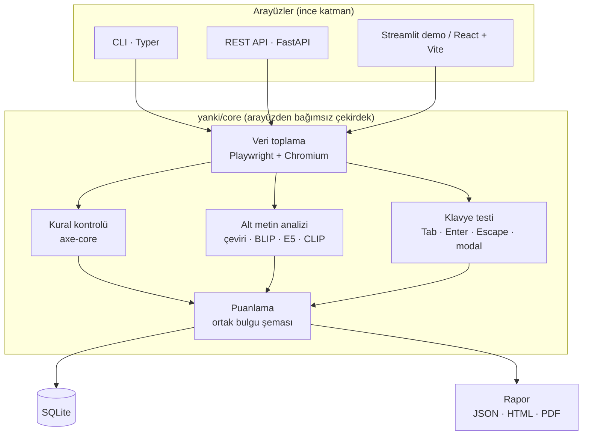

# Yankı

**Yapay zeka destekli web erişilebilirlik denetim ve puanlama aracı.**

Yankı bir web sayfasını kendisi açar ve üç alanda denetler: WCAG 2.2 kuralları, görsel alt metinlerinin anlamı ve klavyeyle gezinme. Bulguların hepsi kanıta dayanır ve tek bir erişilebilirlik puanında toplanır.

> [!NOTE]
> **Durum: Faz 0 öncesi.** Depoda şu an belgeler ve Docker geliştirme ortamı var, henüz uygulama kodu yok. Aşağıdaki `yanki` komutları, API uç noktaları ve hedef metrikler **planlanan** tasarımı anlatır, çalışan bir sürümü değil. Gereksinimlerin tamamı [docs/SRS.md](docs/SRS.md) dosyasındadır.

---

## İçindekiler

- [Neden Yankı?](#neden-yankı)
- [Ne denetler?](#ne-denetler)
- [Mimari](#mimari)
- [Teknoloji yığını](#teknoloji-yığını)
- [Puanlama](#puanlama)
- [Bulgu şeması](#bulgu-şeması)
- [Docker ile kurulum](#docker-ile-kurulum)
- [Planlanan kullanım](#planlanan-kullanım)
- [Depo yapısı](#depo-yapısı)
- [Yol haritası](#yol-haritası)
- [Doğrulama ve hedefler](#doğrulama-ve-hedefler)
- [Gizlilik ve güvenlik](#gizlilik-ve-güvenlik)
- [Kapsam dışı](#kapsam-dışı)
- [Belgeler](#belgeler)
- [Lisans](#lisans)

---

## Neden Yankı?

axe-core, Lighthouse ve WAVE gibi kural tabanlı araçlar sözdizimsel sorunları iyi yakalar. Bir görselde `alt` özniteliği var mı, bir düğmenin adı var mı, bunlara bakarlar. Ama içeriğin anlamını ve sayfanın gerçek kullanımdaki davranışını göremezler:

| Sorun | Kural tabanlı araç | Yankı |
| --- | --- | --- |
| `alt="image1.png"` ya da görselle ilgisi olmayan bir alt metin | Alt metin var, geçer | Görsel ile metnin anlamsal uyumunu ölçer |
| Klavye odağı bir bileşene girip çıkamıyor (klavye tuzağı) | Statik analizde görünmez | Tab ile gezinerek tuzağı yakalar |
| Modal açılınca odak içeri girmiyor, Escape çalışmıyor | Statik analizde görünmez | APG diyalog desenine göre adım adım test eder |

**Ayırt edici iddia:** Kural tabanlı araçların kaçırdığı gerçek hataları, yeni yanlış alarm üretmeden yakalamak. Bu iddia, etiketli veri setleri ve kasıtlı hatalı test sayfalarıyla ölçülebilir hâle getirilir (bkz. [Doğrulama ve hedefler](#doğrulama-ve-hedefler)).

**Hedef kullanıcılar:**

- **Web geliştiriciler:** hatanın nerede olduğunu ve nasıl düzeleceğini görmek ister.
- **Erişilebilirlik ve BT denetçileri:** mevzuat için kanıta dayalı bulgu ister. Cumhurbaşkanlığı Genelgesi 2025/10 bunun bir örneğidir.
- **Kurum yöneticileri:** tek bakışta okunan bir puan ve eğilim ister.
- **Araştırmacılar:** tekrarlanabilir çalıştırma ve ham veri ister.

## Ne denetler?

### 1. Kural kontrolü

Sayfaya axe-core enjekte edilir ve WCAG 2.2 ihlalleri bulunur. Her bulgu ilgili WCAG başarı ölçütüyle eşleştirilir. Bu modül baz çizgisidir; geleneksel araçlarla karşılaştırmanın bir tarafı da budur.

### 2. Alt metin ve içerik analizi

Her görsel için şu adımlar izlenir:

1. Türkçe alt metin İngilizceye çevrilir (`opus-mt-tr-en`).
2. Görselin açıklaması üretilir (BLIP-base).
3. Açıklama ile alt metin arasındaki anlamsal benzerlik ölçülür (multilingual-e5, ana sinyal).
4. Bu benzerlik, CLIP görsel–metin benzerliğiyle (ek sinyal) birleştirilir.

Sonuçta alt metin dört sınıftan birine düşer: **uygun**, **yetersiz**, **uyumsuz**, **eksik**. Bunlara ek olarak:

- `alt=""` ile işaretli dekoratif görseller ayrı tutulur.
- `image1.png`, `resim` gibi genel ifadeler kural dışı desen olarak işaretlenir.
- Her yapay zeka bulgusu 0–1 arası bir güven skoru taşır. Eşiğin altındaki bulgular **"elle incele"** olarak ayrılır.

### 3. Klavye testi

Playwright ile Tab, Shift+Tab, Enter, Boşluk ve Escape basılarak gerçek bir klavye kullanıcısı taklit edilir. Şunlar tespit edilir:

- görünmeyen odak göstergesi;
- odak sırası ile görsel okuma sırası arasındaki sapma;
- klavye tuzağı;
- fareyle tıklanabilen ama klavyeyle erişilemeyen öğeler (`onclick` taşıyan `div`);
- modal davranışı: odak içeri taşınır mı, Tab içeride döner mi, Escape kapatır mı, odak tetikleyiciye geri döner mi.

Her bulgu, adım dizisini ve ekran görüntüsünü kanıt olarak taşır.

## Mimari

Yankı modüler bir boru hattıdır. Tek bir tarama üç bağımsız analiz modülüne dağılır. Modüllerin sonuçları ortak bulgu şemasında birleşir ve puanlanır.



**Temel ilke:** `yanki/core` hiçbir arayüze bağımlı değildir. CLI, API ve Streamlit yalnızca çekirdeği çağıran ince katmanlardır. Bu sayede React arayüzüne geçerken çekirdeğe dokunmak gerekmez.

## Teknoloji yığını

| Katman | Seçim |
| --- | --- |
| Dil | Python 3.11+ |
| Tarayıcı otomasyonu | Playwright (Python), Chromium |
| Kural tabanlı baz çizgisi | axe-core (Playwright'a enjekte) |
| Çeviri (TR→EN) | `opus-mt-tr-en` (varsayılan) |
| Görsel açıklama | BLIP-base (varsayılan) |
| Anlamsal benzerlik | multilingual-e5 (ana sinyal) |
| Görsel–metin uyumu | CLIP (ek sinyal) |
| Arka uç / CLI | FastAPI / Typer |
| Rapor | Jinja2 (HTML, autoescape açık) + Playwright `page.pdf()` (etiketli PDF) |
| Depolama | SQLite |
| Arayüz | Streamlit (ilk sürüm), React + Vite (sonraki sürüm) |
| Dağıtım / test | Docker, pytest |
| Karşılaştırma (yalnızca deneyler) | Lighthouse CLI, WAVE API |

Modeller **CPU'da** çalışacak şekilde tasarlanır. GPU yalnızca isteğe bağlı bir hızlandırmadır.

**Henüz kesinleşmemiş model kararları.** Aşağıdaki seçimler etiketli veri seti (Set A) üzerinde karşılaştırılarak yapılacak ([SRS §8.3](docs/SRS.md#83-model-seçim-protokolü)). O zamana kadar hepsi yapılandırmadan değiştirilebilir kalır:

- görsel açıklama: BLIP-base veya BLIP-2;
- uyum yöntemi: önce çevirip standart CLIP veya doğrudan çok dilli CLIP;
- E5 boyutu: small veya base;
- çeviri modeli: `opus-mt-tr-en` veya `opus-mt-tc-big-tr-en`.

## Puanlama

Her modül 0–100 arası bir alt puan üretir. Genel puan, alt puanların ağırlıklı ortalamasıdır:

```math
S_m = 100 \left( 1 - \min\left(1, \frac{\sum_{i \in F_m} w_i \, c_i}{N_m}\right) \right)
```

```math
P = \alpha_{kural} S_{kural} + \alpha_{icerik} S_{icerik} + \alpha_{klavye} S_{klavye}
```

Formüldeki semboller:

- $F_m$: modülün bulguları;
- $N_m$: o modülde denetlenen öğe sayısı;
- $w_i$: ciddiyet ağırlığı;
- $c_i$: güven skoru (kural bulgularında $c_i = 1$).

| Parametre | Başlangıç değeri |
| --- | --- |
| w (kritik / önemli / orta / düşük) | 1,0 / 0,6 / 0,3 / 0,1 |
| α kural / içerik / klavye | 0,30 / 0,30 / 0,40 |
| Kritik bulgu tavanı | Genel puan ≤ 60 |

> Bunlar **başlangıç değerleridir.** Pilot veriyle kalibre edilecekler. Hepsi yapılandırılabilir ve kullanılan değerler her raporda yazılır. Aynı sürüm ve aynı girdi her zaman aynı puanı üretir.

## Bulgu şeması

Üç modül de bulgularını aynı şemayla üretir:

```json
{
  "id": "f-0042",
  "type": "alt_text",
  "rule": "ALT-06",
  "severity": "important",
  "wcag": ["1.1.1"],
  "selector": "main > section:nth-of-type(2) img",
  "evidence": {
    "alt": "image1.png",
    "alt_translated": "image1.png",
    "caption": "a woman speaking at a podium",
    "similarity": 0.18,
    "screenshot": "evidence/f-0042.png"
  },
  "confidence": 0.91,
  "needs_review": false,
  "recommendation": "Alt metni görselin içeriğini ve sayfadaki işlevini anlatacak şekilde yeniden yazın."
}
```

- `type`: `rule` | `alt_text` | `keyboard`
- `severity`: `critical` | `important` | `moderate` | `low`

## Docker ile kurulum

Yankı **Docker ile** çalışır ve geliştirilir. Bunun için yerelde Python, Playwright ya da Chromium kurmak gerekmez; tek gereksinim [Docker](https://docs.docker.com/get-docker/) (Docker Desktop veya Docker Engine + Compose). Windows, Linux ve macOS'ta aynı ortam elde edilir (NFR-11).

```bash
git clone https://github.com/Mustafayildiiz/Yanki.git
cd Yanki
docker compose build              # imajı oluştur
docker compose run --rm yanki     # konteynerde kabuk aç
```

İmaj neler içerir:

- **Taban:** Playwright'ın resmi Python imajı (`mcr.microsoft.com/playwright/python:v1.65.2-noble`). Chromium ve sistem bağımlılıkları hazır gelir. Python `playwright` paketi ise Faz 0'da kilitli bağımlılıklarla kurulur.
- **Python ortamı:** `/opt/venv`. Bağımlılıklar kilit dosyasından kurulur (Faz 0 ile eklenecek).
- **Model önbelleği:** `yanki-models` volume'ü (`/models`). Model ağırlıkları bir kez indirilir, sonraki çalıştırmalar çevrimdışıdır.
- **Kaynak kod:** `/app` dizinine bind mount ile bağlanır. Kod değişince yeniden build gerekmez, yalnızca bağımlılık değişince gerekir.

Güvenlik ve donanım ayrıntıları:

- **Yalıtım (NFR-09):** Konteyner root olmayan `pwuser` kullanıcısıyla, `no-new-privileges` ile ve tüm Linux yetenekleri kapalı olarak çalışır. Chromium için `/dev/shm` 1 GB'a çıkarılmıştır.
- **CPU varsayılan (NFR-12):** `YANKI_DEVICE=cpu`. NVIDIA GPU'lu bir makinede CUDA kullanmak için compose'a GPU erişimi eklenip `--device cuda` verilebilir. Docker Desktop'ta AMD GPU geçişi yoktur; bu durumda CPU kullanılır.
- **Yerel sayfa taraması:** Konteyner içinde `localhost` konteynerin kendisidir. Ana makinede çalışan bir sayfayı taramak için `host.docker.internal` adresi kullanılır. Yerel ağ adresleri varsayılan olarak engelli olduğundan (NFR-08) bunun için açık izin ayarı da gerekir.

## Planlanan kullanım

> Bu bölüm hedeflenen arayüzü anlatır. `yanki` komutları henüz çalışmaz.

### Komut satırı

Komutlar konteyner içinde çalışır. Dışarıdan tek seferlik çalıştırmak için başlarına `docker compose run --rm yanki` eklenir:

```bash
# Tek sayfa tarama, birden çok rapor biçimi
docker compose run --rm yanki yanki scan https://ornek.gov.tr --format json,html,pdf

# URL listesini toplu tarama
docker compose run --rm yanki yanki batch siteler.txt

# CI'da kullanım: puan 80'in altındaysa ya da kritik bulgu varsa başarısız ol
docker compose run --rm yanki yanki scan https://ornek.gov.tr --min-score 80 --fail-on critical

# Testler
docker compose run --rm yanki pytest
```

Raporlar bind mount sayesinde proje klasörüne yazılır ve ana makineden doğrudan açılabilir.

| Çıkış kodu | Anlamı |
| --- | --- |
| 0 | Başarılı |
| 1 | Eşik aşıldı |
| 2 | Kullanım hatası |
| 3 | Tarama yapılamadı |

### REST API

| Uç nokta | Açıklama |
| --- | --- |
| `POST /scans` | Yeni tarama başlatır, tarama kimliği döner |
| `GET /scans/{id}` | Tarama durumunu ve genel puanı döner |
| `GET /scans/{id}/findings` | Bulguları ciddiyete ve türe göre filtreleyerek listeler |
| `GET /scans/{id}/report?format=` | JSON, HTML veya PDF rapor döner |
| `GET /health` | Servisin ve model yüklemesinin durumunu döner |

## Depo yapısı

Hedeflenen yapı (Faz 0 ile oluşturulacak):

```text
yanki/
  core/              # arayüzden bağımsız çekirdek
    scan.py          # Playwright ile sayfa yükleme ve veri toplama
    rules.py         # axe-core entegrasyonu
    alttext/         # çeviri, BLIP, CLIP, E5, önbellek, sınıflandırma
    keyboard/        # Tab gezisi, odak, tuzak, modal testleri
    scoring.py       # puanlama
    report/          # JSON, HTML (Jinja2), PDF
    schema.py        # bulgu şeması (pydantic)
  cli.py             # Typer
  api/               # FastAPI
  ui/streamlit_app.py
  config.py          # model seçimleri, eşikler, ağırlıklar
fixtures/
  known_issues/      # kasıtlı hatalı sayfalar + *.expected.json (Set B)
  clean/             # hatasız referans sayfalar (Set C)
  alt_text_labeled/  # etiketli görsel seti (Set A)
experiments/         # model karşılaştırma ve değerlendirme betikleri
tests/
docs/
  SRS.md             # yazılım gereksinim belirtimi
Dockerfile           # çalışma ve geliştirme imajı (mevcut)
compose.yaml         # geliştirme ortamı (mevcut)
```

## Yol haritası

| Faz | Kapsam | Gereksinimler | Durum |
| --- | --- | --- | --- |
| 0 | İskelet: repo, `pyproject.toml`, CI, `yanki scan` ile axe-core → JSON (Docker ortamı hazır) | TAR-01..05, KUR-01..03, RAP-01 (JSON), NFR-08/11/15 | ⏳ Sıradaki |
| 1 | Klavye modülü ve Set B/C test sayfaları | KLV-01..10, NFR-04/05 | Planlandı |
| 2 | Alt metin analizi ve model karşılaştırma deneyi | ALT-01..12, NFR-01/03/12/13 | Planlandı |
| 3 | Puanlama, HTML/PDF rapor, CI eşikleri | PUA-01..05, RAP-01..06, CLI-01..04 | Planlandı |
| 4 | REST API, SQLite, Streamlit demo | API-01..05, UI-01, UI-03..06 | Planlandı |
| 5 | Toplu tarama, Lighthouse/WAVE karşılaştırması, CSV | KAR-01..05 | Planlandı |
| 6 | React + Vite arayüzü | UI-02 | Sonra |

Klavye modülü, aracın en ayırt edici ve ML riski taşımayan parçası olduğu için alt metin analizinden önce yapılır.

## Doğrulama ve hedefler

Yankı'nın başarısı, doğru cevabı önceden bilinen veri üzerinde ölçülür:

| Set | İçerik | Hedef boyut |
| --- | --- | --- |
| A | Etiketli görsel + alt metin çiftleri (iki etiketleyici, Cohen kappa) | 150–200 görsel |
| B | Bilinen hataları listelenmiş, kasıtlı hatalı test sayfaları | 5–10 sayfa |
| C | Erişilebilirlik kurallarına uygun, hatasız referans sayfalar | 3–5 sayfa |
| D | Gerçek Türk üniversite, belediye ve banka siteleri (uzman doğrulamalı) | 20–30 site |

**Hedef metrikler.** Bunlar başlangıç hedefleridir, ölçülmüş sonuçlar değildir:

| Metrik | Hedef |
| --- | --- |
| Alt metin sınıflandırması (Set A) | makro F1 ≥ 0,80 |
| Klavye hatası yakalama duyarlılığı (Set B) | ≥ %90 |
| Yanlış alarm oranı (Set C) | sayfa başına ≤ %5 |
| Alt metin analizi süresi (CPU, önbellek dışı) | görsel başına ≤ 3 sn |
| Tam sayfa taraması (50 görsel, 100 odaklanabilir öğe, CPU) | ≤ 5 dk |
| Puan ile bilinen hata yükü arasındaki sıra korelasyonu | Spearman ile raporlanır |

Hedef donanım 8 çekirdekli CPU ve 16 GB RAM'dir. Bir hedef tutmazsa sapma ve olası nedeni gizlenmeden raporlanır.

## Gizlilik ve güvenlik

- **Yerel çıkarım:** Taranan sayfanın içeriği ve görselleri hiçbir üçüncü taraf servise gönderilmez. Tüm modeller yerelde çalışır; internetten yalnızca model ağırlıkları indirilir.
- **SSRF koruması:** Yalnızca `http` ve `https` kabul edilir. Yerel ağ ve `localhost` adresleri varsayılan olarak engellidir, ancak açık bir ayarla izin verilebilir.
- **Yalıtım:** Tarayıcı yalıtılmış bir profilde çalışır. Taranan sayfanın kodu ana süreçte çalışmaz.
- **Kaçışlama:** Raporlara giren sayfa kaynaklı metinler (alt metin, düğme adı vb.) her zaman kaçışlanır.
- **Kendi erişilebilirliği:** Yankı'nın arayüzü ve HTML raporları WCAG 2.2 AA'ya uyar. Bu, Yankı'nın kendi kendini taramasıyla doğrulanır.
- **Sorumlu tarama:** Hız sınırı uygulanır ve robots.txt'e saygı gösterilir. Yalnızca izinli siteleri ya da kendi sitelerinizi tarayın.

## Kapsam dışı

- Mobil uygulama (iOS, Android) denetimi
- Gerçek ekran okuyucularla (NVDA, JAWS, VoiceOver) otomatik test
- Bulunan hataların otomatik düzeltilmesi (Yankı yalnızca öneri sunar)
- Video ve ses içeriğinde altyazı kalitesi analizi
- Hukuki uygunluk kararı veya sertifika üretimi (Yankı bir denetim yardımcısıdır)

## Belgeler

- [Yazılım Gereksinim Belirtimi (SRS)](docs/SRS.md): tüm fonksiyonel ve fonksiyonel olmayan gereksinimler, puanlama modeli, doğrulama protokolü ve riskler.
- [CLAUDE.md](CLAUDE.md): yapay zeka destekli geliştirme için çalışma kuralları.

## Lisans

Lisans henüz belirlenmedi.
