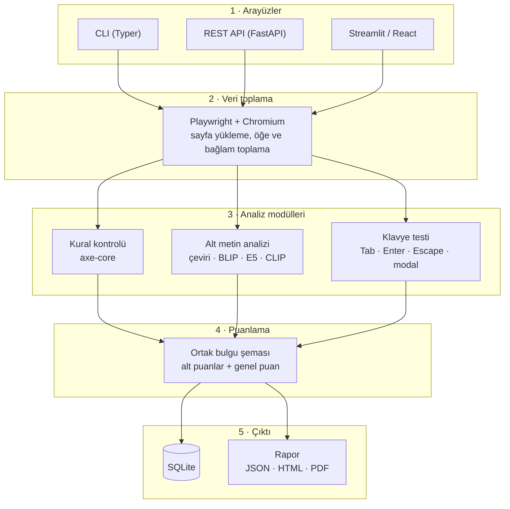

# Yankı – Yazılım Gereksinim Belirtimi (SRS)

16 Kasım 2026 · Mustafa Yıldız

## 1. Giriş

Bu doküman, Yankı web erişilebilirlik denetim ve puanlama aracının yazılım gereksinimlerini tanımlar; geliştirme, test ve TÜBİTAK başvuru sürecinde ortak referans olarak kullanılır.

### 1.1 Amaç

Dokümanın amacı, Yankı'nın ne yapacağını (fonksiyonel gereksinimler), hangi kalite düzeyinde yapacağını (fonksiyonel olmayan gereksinimler) ve başarının nasıl doğrulanacağını (kabul kriterleri) belirsizliğe yer bırakmadan ortaya koymaktır. Yapı, ISO/IEC/IEEE 29148:2018 standardındaki gereksinim belirtimi içeriğini temel alır.

### 1.2 Kapsam

Yankı, bir web sayfasını otomatik olarak açıp üç alanda denetleyen ve sonucu tek bir erişilebilirlik puanı ile ayrıntılı rapor olarak sunan bir araçtır:

- **Kural tabanlı kontrol:** WCAG 2.2 ihlallerinin axe-core ile tespiti (baz çizgisi).
- **İçerik kontrolü:** Görsellerin alt metinlerinin görsele ve sayfaya anlamsal olarak uygun olup olmadığının yapay zeka ile değerlendirilmesi.
- **Klavye ile gezinme testi:** Tab, Enter ve Escape ile gezinen bir kullanıcının simülasyonu; odak sırası, odak kaybı, klavye tuzağı ve modal pencere davranışının denetimi.

Kapsam dışı konular 9. bölümde listelenmiştir (ör. mobil uygulamalar, ekran okuyucu ile gerçek kullanıcı testi, otomatik düzeltme).

### 1.3 Tanımlar ve kısaltmalar

| Terim | Açıklama |
| --- | --- |
| WCAG | W3C Web İçeriği Erişilebilirlik Yönergeleri (bu projede sürüm 2.2) |
| APG | W3C WAI-ARIA Authoring Practices Guide |
| ARIA | Erişilebilir Zengin İnternet Uygulamaları (WAI-ARIA) öznitelikleri |
| Alt metin | Görselin `alt` özniteliğindeki alternatif metin |
| Klavye tuzağı | Klavye odağının girdiği bir bileşenden klavye ile çıkılamaması |
| Bulgu | Yankı'nın tespit ettiği tek bir erişilebilirlik sorunu |
| Güven skoru | Yapay zeka tabanlı bir bulgunun doğruluğuna ilişkin 0–1 arası tahmin |
| SRS | Yazılım Gereksinim Belirtimi |
| CLIP | Görsel ile metni ortak uzayda eşleştiren model |
| E5 | Çok dilli metin gömme (embedding) modeli ailesi |

### 1.4 Referanslar

- W3C, Web Content Accessibility Guidelines (WCAG) 2.2, 2023.
- W3C WAI, WAI-ARIA Authoring Practices Guide, Dialog (Modal) Pattern.
- ISO/IEC/IEEE 29148:2018, Systems and software engineering — Life cycle processes — Requirements engineering.
- Yankı araştırma önerisi, "Yankı: Yapay Zeka Destekli Web Erişilebilirlik Denetim ve Puanlama Aracı" (TÜBİTAK başvuru metni).
- Cumhurbaşkanlığı Genelgesi 2025/10, Web Siteleri ve Mobil Uygulamaların Erişilebilirliği.

## 2. Genel Tanım

Yankı, kurulumu kolay, yerelde çalışan ve GPU gerektirmeyen bir denetim aracıdır; kural tabanlı araçların kaçırdığı anlamsal ve etkileşimsel sorunları yakalamayı hedefler.

### 2.1 Ürün perspektifi

Yankı bağımsız bir üründür. Tarayıcı otomasyonu için Playwright, kural tabanlı taban çizgisi için axe-core kullanır. Lighthouse ve WAVE, ürünün bir parçası değil, yalnızca karşılaştırma deneylerinde başvurulan dış araçlardır.

### 2.2 Ürün işlevlerinin özeti

- Verilen URL'yi (veya yerel HTML dosyasını) açıp sayfa içeriğini toplamak.
- WCAG 2.2 kural ihlallerini axe-core ile bulmak.
- Görsel alt metinlerinin görsele ve sayfa bağlamına uygunluğunu yapay zeka ile ölçmek.
- Düğme ve bağlantı adlarının işlevi anlatıp anlatmadığını değerlendirmek.
- Klavye ile gezinmeyi simüle edip odak sorunlarını ve klavye tuzaklarını saptamak.
- Bulguları tek bir erişilebilirlik puanında ve ayrıntılı raporda birleştirmek.
- Sonuçları geleneksel araçlarla karşılaştırmak.

### 2.3 Kullanıcı sınıfları

| Kullanıcı | Tanım | Ana ihtiyacı |
| --- | --- | --- |
| Web geliştirici | Siteyi yazan ve düzelten kişi | Hatanın nerede olduğunu ve nasıl düzeleceğini görmek |
| Erişilebilirlik/BT denetçisi | Kurum sitelerini mevzuata göre inceleyen kişi | Güvenilir, kanıta dayalı, raporlanabilir bulgu |
| Kurum yöneticisi | Uyum durumunu izleyen kişi | Tek bakışta genel puan ve eğilim |
| Araştırmacı | Yöntemi doğrulayan kişi | Tekrarlanabilir çalıştırma ve ham veri |

### 2.4 Çalışma ortamı

- Python 3.11 veya üzeri, Playwright Chromium, işletim sistemi: Windows, Linux, macOS.
- Modeller CPU üzerinde çalışabilmeli; GPU yalnızca hızlandırma için isteğe bağlıdır.
- Docker imajı ile taşınabilir dağıtım.

### 2.5 Tasarım ve gerçekleştirme kısıtları

- Taranan sayfa verisi dışarı çıkmamalı; modeller yerelde çalışmalı.
- Yalnızca açık kaynak veya lisansı uygun modeller ve kütüphaneler kullanılmalı.
- WCAG 2.2 temel başvuru standardıdır; modal davranışları APG diyalog desenine göre kontrol edilir.
- Alt metin analizi Türkçe ve İngilizce içerikte çalışmalıdır.
- Geliştirme ortamında GPU erişimi garanti değildir (AMD RX 6700S); ağır deneyler Colab/Kaggle gibi dış ortamlarda yapılır.

### 2.6 Varsayımlar ve bağımlılıklar

- Hedef sayfalar herkese açıktır veya kullanıcı oturum çerezini kendisi sağlar.
- Model ağırlıkları ilk çalıştırmada indirilebilir; sonrasında çevrimdışı çalışabilir.
- Doğrulama için elle etiketlenmiş bir görsel veri seti ve kasıtlı hatalı test sayfaları hazırlanacaktır (8. bölüm).

## 3. Sistem Mimarisi ve Teknoloji Yığını

Yankı modüler bir boru hattıdır: tek bir tarama, üç bağımsız analiz modülüne dağılır ve sonuçlar ortak bulgu şemasında puanlama katmanında birleşir.



Arayüzler taramayı başlatır; veri toplama sonucu üç modüle dağıtılır, puanlama bulguları birleştirip depolar ve rapora çevirir.

### 3.1 Teknoloji yığını

| Katman | Seçim | Gerekçe |
| --- | --- | --- |
| Dil | Python 3.11+ | ML kütüphaneleri ve Playwright aynı dilde |
| Tarayıcı otomasyonu | Playwright (Python), Chromium | Klavye simülasyonu, odak izleme ve modal testi |
| Kural tabanlı taban çizgisi | axe-core (Playwright'a enjekte) | Karşılaştırmanın geleneksel araç tarafı; kural bulguları |
| Karşılaştırma araçları | Lighthouse CLI, WAVE API | Yalnızca deneylerde; WAVE abonelik API'si Set D ana sayfaları için kullanılır (yeni hesapta 100 ücretsiz kredi, temel analiz sayfa başına 1 kredi) |
| Görsel açıklama | BLIP-base (varsayılan), BLIP-2 (isteğe bağlı) | CPU'da çalışabilir hafif model; BLIP-2 Colab'da |
| Görsel–metin uyumu | CLIP + çeviri modeli (TR→EN) | Türkçe alt metin İngilizceye çevrilip puanlanır; doğrudan çok dilli CLIP alternatiftir |
| Anlamsal benzerlik | multilingual-e5 (small/base) | Açıklama ile (çevrilmiş) alt metni karşılaştırır; ana sinyal |
| Çeviri modeli | opus-mt-tr-en (varsayılan), opus-mt-tc-big-tr-en (alternatif) | Varsayılan model küçük ve Apache-2.0 lisanslı; alternatifin lisansı kullanımdan önce kontrol edilmeli, ikisi 8.3'te karşılaştırılır |
| Arka uç | FastAPI | Hafif, JSON çıktı için uygun |
| Komut satırı | Typer | Click üzerine kurulu, tip ipuçlarıyla yazılır; FastAPI ile aynı yazarın aracı olduğundan yığınla uyumlu |
| Rapor üretimi | Jinja2 (HTML şablon) + Playwright page.pdf() (PDF) | Ek bağımlılık gerekmez; PDF yalnızca Chromium'da üretilir, etiketli (tagged) ve içindekiler (outline) seçenekleri açık kullanılır |
| Depolama | SQLite | Kurulum gerektirmez, yerel |
| Arayüz | Streamlit (demo), React + Vite (profesyonel) | Erişilebilir yerel HTML; Flutter Web tercih edilmedi |
| Dağıtım | Docker | Tekrarlanabilir kurulum |
| Test | pytest | Gereksinim bazlı otomatik testler |
| Deney ortamı | Colab / Kaggle GPU | Yerelde GPU erişimi garanti değil |

Modeller `fp16` veya 8-bit nicemleme ile, mimari katman GPU'ya bağımlı olmadan tasarlanır (NFR-12).

## 4. Fonksiyonel Gereksinimler

Yankı yedi işlev grubunda 47 test edilebilir gereksinim karşılar. Öncelik: **Z** zorunlu (ilk sürüm), **Ö** önerilen (sonraki sürüm). Her gereksinim, 8. bölümdeki bir test ile izlenir.

### 4.1 Tarama ve veri toplama (TAR)

| No | Gereksinim | Öncelik |
| --- | --- | --- |
| TAR-01 | Sistem girdi olarak bir URL veya yerel HTML dosyası kabul etmelidir. | Z |
| TAR-02 | Sayfa Playwright ile Chromium'da açılmalı, ağ etkinliği dinene kadar beklenmeli ve zaman aşımı yapılandırılabilir olmalıdır. | Z |
| TAR-03 | Görseller, düğmeler, bağlantılar ve form alanları toplanmalı; her öğe için çevreleyen metin ve en yakın başlık bilgisi bağlam olarak saklanmalıdır. | Z |
| TAR-04 | Görünüm alanı boyutu ve sayfa dili yapılandırılabilir olmalıdır. | Ö |
| TAR-05 | Sayfa açılamazsa işlem anlaşılır bir hata kodu ve mesajıyla sonlanmalıdır. | Z |
| TAR-06 | Tek sayfalı uygulamalarda (SPA) dinamik olarak yüklenen içerik, tarama öncesi bekleme koşulu ile yakalanabilmelidir. | Ö |

### 4.2 Kural tabanlı kontrol (KUR)

| No | Gereksinim | Öncelik |
| --- | --- | --- |
| KUR-01 | Sayfa üzerinde axe-core çalıştırılmalı ve ihlaller ortak bulgu şemasına (6.4) dönüştürülmelidir. | Z |
| KUR-02 | Her kural bulgusu ilgili WCAG başarı ölçütü numarasıyla ilişkilendirilmelidir. | Z |
| KUR-03 | Kullanılan axe-core sürümü raporda belirtilmelidir. | Z |

### 4.3 Alt metin ve içerik analizi (ALT)

| No | Gereksinim | Öncelik |
| --- | --- | --- |
| ALT-01 | Alt metni olmayan her bilgi verici görsel, "eksik" bulgusu olarak raporlanmalıdır. | Z |
| ALT-02 | `alt=""` veya `role="presentation"` ile dekoratif işaretlenmiş görseller ayrı sınıflandırılmalı, puanlamaya yanlış alarm olarak katılmamalıdır. | Z |
| ALT-03 | Alt metni olan her görsel için görsel–metin uyum skoru (0–1) üretilmelidir. | Z |
| ALT-04 | Alt metin sayfa dili İngilizce değilse önce İngilizceye çevrilmeli (örn. MarianMT opus-mt-tr-en, CPU'da çalışır). Uyum skoru, çevrilmiş metin ile görsel açıklaması arasındaki E5 benzerliği (ana sinyal) ile standart CLIP görsel–metin benzerliğinin (ek sinyal) birleşimi olmalıdır. Özgün ve çevrilmiş metin kanıt olarak saklanmalı, doğrudan çok dilli yöntem yapılandırma ile seçilebilmelidir. | Z |
| ALT-05 | Görsel açıklaması üreten bir model (varsayılan BLIP-base, isteğe bağlı BLIP-2) ile üretilen açıklama, alt metinle karşılaştırılmalıdır. | Z |
| ALT-06 | Alt metin dört sınıftan birine atanmalıdır: uygun, yetersiz, uyumsuz, eksik. Eşikler yapılandırılabilir olmalıdır. | Z |
| ALT-07 | "image1.png", "resim", "foto" gibi dosya adı veya genel ifadeli alt metinler kural dışı deseniyle ayrıca işaretlenmelidir. | Z |
| ALT-08 | Her yapay zeka bulgusu 0–1 arası güven skoru taşımalı; eşiğin altındaki bulgular "elle incele" olarak işaretlenmelidir. | Z |
| ALT-09 | Aynı görsel (içerik karma değeri) tekrar analiz edilmemeli, sonuç önbellekten gelmelidir. | Z |
| ALT-10 | İndirilemeyen veya çözülemeyen görseller atlanıp raporda "analiz edilemedi" olarak belirtilmelidir. | Z |
| ALT-11 | Düğme ve bağlantıların erişilebilir adı ile çevreleyen işlev bağlamının uyumu değerlendirilmelidir (ör. "tıklayın", "devam" gibi belirsiz adlar). | Ö |
| ALT-12 | Alt metin dili sayfa dilinden farklıysa bulgu olarak belirtilmelidir. | Ö |

### 4.4 Klavye ile gezinme testi (KLV)

| No | Gereksinim | Öncelik |
| --- | --- | --- |
| KLV-01 | Sistem, Tab ile sayfadaki odaklanabilir öğeleri sırayla gezmeli ve her adımda öğenin türünü, erişilebilir adını ve ekran konumunu kaydetmelidir. | Z |
| KLV-02 | Shift+Tab ile ters yönde de gezinme yapılmalıdır. | Ö |
| KLV-03 | Odak göstergesi görünmeyen öğeler tespit edilmelidir. | Z |
| KLV-04 | Odak sırası ile görsel okuma sırası arasındaki belirgin sapmalar tespit edilmelidir. | Z |
| KLV-05 | Odak, yapılandırılabilir bir adım sınırı içinde ilerlemiyorsa veya aynı öğeler arasında dönüyorsa "klavye tuzağı" bulgusu üretilmelidir. | Z |
| KLV-06 | Fare ile tıklanabilir görünüp Tab ile erişilemeyen öğeler (ör. `onclick` taşıyan `div`) bulgu olarak raporlanmalıdır. | Z |
| KLV-07 | Enter ve Boşluk ile etkinleştirilemeyen düğme benzeri öğeler tespit edilmelidir. | Ö |
| KLV-08 | Açılan modal pencerede şunlar test edilmelidir: odak pencerenin içine taşınır, Tab pencere içinde döner, Escape pencereyi kapatır, kapanınca odak tetikleyen öğeye döner (APG diyalog deseni). | Z |
| KLV-09 | "Ana içeriğe atla" bağlantısının varlığı ve çalıştığı kontrol edilmelidir. | Ö |
| KLV-10 | Her klavye bulgusu kanıt olarak ilgili adım dizisini ve odağın son durumunu içeren ekran görüntüsünü taşımalıdır. | Z |

### 4.5 Puanlama (PUA)

| No | Gereksinim | Öncelik |
| --- | --- | --- |
| PUA-01 | Sistem üç alt puan üretmelidir: kural uyumu, içerik kalitesi, klavye başarısı (her biri 0–100). | Z |
| PUA-02 | Genel puan, alt puanların ağırlıklı birleşimi olmalıdır; ağırlıklar yapılandırılabilir ve raporda gösterilmelidir. | Z |
| PUA-03 | Bulgular ciddiyete göre (kritik, önemli, orta, düşük) ağırlıklandırılmalıdır; klavye tuzağı gibi erişimi engelleyen bulgular en yüksek ciddiyette olmalıdır. | Z |
| PUA-04 | Puan formülü belgelenmeli ve aynı girdi ile aynı sürümde aynı puan üretilmelidir (belirlenimcilik). | Z |
| PUA-05 | "Elle incele" işaretli bulgular puana ayrı gösterilmeli, kesin bulgulardan ayırt edilebilmelidir. | Ö |

### 4.6 Raporlama (RAP)

| No | Gereksinim | Öncelik |
| --- | --- | --- |
| RAP-01 | Rapor JSON, HTML ve PDF biçiminde üretilebilmelidir. PDF, Playwright page.pdf() ile etiketli (tagged) ve içindekiler (outline) açık üretilmeli, etiketli PDF'in erişilebilirliği ayrıca doğrulanmalıdır; HTML şablonunda taranan sayfadan gelen metin kaçışlanmalıdır. | Z |
| RAP-02 | Her bulgu; kural, ciddiyet, WCAG ölçütü, öğe seçicisi, kanıt, güven skoru ve düzeltme önerisi alanlarını içermelidir. | Z |
| RAP-03 | Rapor, özet puan paneli ve bulgu listesini birlikte sunmalı; bulgular ciddiyete ve türe göre filtrelenebilmelidir. | Z |
| RAP-04 | Komut satırı aracı, puan veya ciddiyet eşiği aşıldığında sıfırdan farklı çıkış kodu döndürmelidir (CI entegrasyonu). | Z |
| RAP-05 | Rapor taramada kullanılan sürümleri (Yankı, axe-core, model adı ve sürümü) ve tarih bilgisini içermelidir. | Z |
| RAP-06 | İki taramayı karşılaştıran "önce/sonra" görünümü sunulmalıdır. | Ö |

### 4.7 Karşılaştırma ve toplu tarama (KAR)

| No | Gereksinim | Öncelik |
| --- | --- | --- |
| KAR-01 | Birden çok URL içeren bir listeyi toplu taramalı ve sonuçları tek tabloda toplamalıdır. | Z |
| KAR-02 | Lighthouse ve WAVE çıktıları içe aktarılabilmeli ve ortak şemaya eşlenmelidir. | Z |
| KAR-03 | Yankı'nın bulduğu ama karşılaştırılan araçların kaçırdığı bulgular otomatik hesaplanmalıdır. | Z |
| KAR-04 | Sonuçlar CSV olarak dışa aktarılabilmelidir. | Z |
| KAR-05 | Her taramada rastlantısallık kaynağı (tohum) ve araç sürümleri kaydedilerek deneyler tekrarlanabilir olmalıdır. | Z |

## 5. Fonksiyonel Olmayan Gereksinimler

Sayısal hedefler başlangıç değerleridir; pilot ölçümlerden sonra danışman hocayla birlikte kesinleştirilmelidir.

| No | Kategori | Gereksinim | Öncelik |
| --- | --- | --- | --- |
| NFR-01 | Performans | Alt metin analizi CPU üzerinde görsel başına ortalama en fazla 3 saniyede tamamlanmalıdır (önbellek dışı); hedef donanım 8 çekirdekli CPU, 16 GB RAM. | Z |
| NFR-02 | Performans | Ortalama bir sayfanın (50 görsel, 100 odaklanabilir öğe) tam taraması CPU üzerinde 5 dakikayı geçmemelidir. | Z |
| NFR-03 | Doğruluk | Alt metin sınıflandırması, 8. bölümdeki etiketli veri kümesinde makro F1 ≥ 0,80 sağlamalıdır (hedef). | Z |
| NFR-04 | Doğruluk | Klavye modülü, kasıtlı hatalı test sayfalarındaki bilinen klavye hatalarının en az %90'ını yakalamalıdır (duyarlılık, hedef). | Z |
| NFR-05 | Doğruluk | Hatasız test sayfalarında yanlış alarm oranı sayfa başına %5'i geçmemelidir (hedef). | Z |
| NFR-06 | Tekrarlanabilirlik | Aynı sürüm ve aynı girdi ile iki tarama aynı bulgu kümesini ve aynı puanı üretmelidir. | Z |
| NFR-07 | Gizlilik | Taranan sayfa içeriği ve görseller üçüncü taraf servislere gönderilmemeli; model çıkarımı yerelde yapılmalıdır. | Z |
| NFR-08 | Güvenlik | Yalnızca http ve https şemaları kabul edilmeli; yerel ağ adresleri (SSRF riski) varsayılan olarak engellenmeli, açık bir ayarla izin verilmelidir. | Z |
| NFR-09 | Güvenlik | Tarayıcı oturumu yalıtılmış bir profilde çalışmalı; taranan sayfanın kodu ana sistemde çalıştırılmamalıdır. | Z |
| NFR-10 | Erişilebilirlik | Yankı'nın kendi arayüzü ve HTML raporları WCAG 2.2 AA'ya uymalı ve Yankı tarafından kendi kendine taranarak doğrulanmalıdır. | Z |
| NFR-11 | Taşınabilirlik | Windows, Linux ve macOS üzerinde çalışmalı; tek komutla Docker ile kurulabilmelidir. | Z |
| NFR-12 | Taşınabilirlik | GPU yoksa otomatik olarak CPU kullanılmalı, GPU varsa yapılandırma ile seçilebilmelidir. | Z |
| NFR-13 | Modülerlik | Alt metin, klavye ve puanlama modülleri ortak bir arayüz üzerinden birbirinden bağımsız değiştirilebilmeli; model değiştirmek kod değişikliği gerektirmeden ayardan yapılabilmelidir. | Z |
| NFR-14 | Bakım | Kod kapsam oranı en az %70 olmalı; tüm gereksinimler otomatik testlerle izlenmelidir. | Ö |
| NFR-15 | Bakım | Bağımlılıklar ve model sürümleri sabitlenmeli (kilit dosyası); bağımlılık lisansları listelenmelidir. | Z |
| NFR-16 | Dayanıklılık | Tek bir görselin veya öğenin analiz hatası tüm taramayı durdurmamalı, hata raporda belirtilmelidir. | Z |
| NFR-17 | Dil | Kullanıcı arayüzü ve raporlar Türkçe ve İngilizce sunulabilmelidir. | Ö |
| NFR-18 | Gözlemlenebilirlik | Tarama adımları süre ve hata bilgisiyle günlüğe yazılmalıdır. | Ö |

## 6. Arayüz Gereksinimleri

Yankı üç arayüzle kullanılır ve hepsi aynı çekirdek kütüphaneyi ve aynı bulgu şemasını paylaşır.

### 6.1 Kullanıcı arayüzü

| No | Gereksinim | Öncelik |
| --- | --- | --- |
| UI-01 | Hızlı demo sürümü Streamlit ile geliştirilmelidir: URL girişi, tarama başlatma, puan paneli, bulgu listesi. | Z |
| UI-02 | Profesyonel sürüm React + Vite ile geliştirilmeli, REST API'yi tüketmelidir. | Ö |
| UI-03 | Bulgu ayrıntısında kanıt gösterilmelidir: görsel ve alt metin, benzerlik skoru, klavye adım dizisi, ekran görüntüsü. | Z |
| UI-04 | Uzun süren taramalarda ilerleme durumu gösterilmelidir. | Z |
| UI-05 | Arayüz tamamıyla klavye ile kullanılabilmeli, anlamlı etiket ve yeterli renk kontrastı taşımalıdır (NFR-10). | Z |
| UI-06 | Renk tek başına bilgi taşımayıp ciddiyet, simge ve metinle de belirtilmelidir. | Z |

### 6.2 Komut satırı arayüzü

| No | Gereksinim | Öncelik |
| --- | --- | --- |
| CLI-01 | `yanki scan <url>` komutu taramayı başlatmalı, `--format json,html,pdf` ile çıktı biçimi seçilebilmelidir. | Z |
| CLI-02 | `yanki batch <dosya>` komutu URL listesini toplu taramalıdır. | Z |
| CLI-03 | `--min-score` ve `--fail-on` seçenekleri CI'da başarısızlığı önceden belirlenen eşikle tetiklemelidir (RAP-04). Çıkış kodları: 0 başarılı, 1 eşik aşıldı, 2 kullanım hatası, 3 tarama yapılamadı. | Z |
| CLI-04 | `--device cpu\|cuda` ile çalıştırma aygıtı seçilebilmelidir (NFR-12). | ? (kaynak dokümanda belirtilmemiş) |

### 6.3 REST API

| No | Uç nokta | Açıklama |
| --- | --- | --- |
| API-01 | `POST /scans` | Yeni tarama oluşturur, tarama kimliği döner |
| API-02 | `GET /scans/{id}` | Tarama durumu ve genel puanı döner |
| API-03 | `GET /scans/{id}/findings` | Bulguları ciddiyet ve türe göre filtreli listeler |
| API-04 | `GET /scans/{id}/report?format=` | JSON, HTML veya PDF rapor döner |
| API-05 | `GET /health` | Servis ve model yükleme durumunu döner |

### 6.4 Bulgu şeması (JSON)

Tüm modüller bulguları aşağıdaki şekilde üretir. Alanlar sabit; yeni türler `type` alanıyla eklenir.

```json
{
  "id": "f-0042",
  "type": "alt_text",
  "rule": "ALT-06",
  "severity": "important",
  "wcag": ["1.1.1"],
  "selector": "main > section:nth-of-type(2) img",
  "evidence": {
    "alt": "image1.png",
    "caption": "a woman speaking at a podium",
    "similarity": 0.18,
    "screenshot": "evidence/f-0042.png"
  },
  "confidence": 0.91,
  "needs_review": false,
  "recommendation": "Alt metni görselin içeriğini ve sayfadaki işlevini anlatacak şekilde yeniden yazın."
}
```

## 7. Veri Gereksinimleri ve Puanlama Modeli

Genel puan, her modülün bulgu ağırlığından üretilen 0–100 arası alt puanların ağırlıklı ortalamasıdır; ağırlıklar başlangıç değerleridir ve pilot veriyle kalibre edilir.

### 7.1 Veri modeli

| Varlık | Ana alanlar | Not |
| --- | --- | --- |
| Scan | id, url, başlama/bitiş zamanı, araç sürümleri, yapılandırma | Bir tarama koşusu |
| Element | scan_id, tür, seçici, erişilebilir ad, bağlam metni | Görsel, düğme, bağlantı, form alanı |
| ImageAnalysis | element_id, görsel karması, açıklama, E5 ve CLIP skorları, sınıf | Karma ile önbelleklenir (ALT-09) |
| KeyboardStep | scan_id, sıra no, element_id, konum, odak göstergesi var mı | Tab adımı kaydı |
| Finding | 6.4'teki şema | Tüm modüllerin ortak çıktısı |
| Score | scan_id, üç alt puan, genel puan, ağırlıklar | Hesaplama girdileriyle birlikte saklanır |

Veriler yerel SQLite'ta tutulur, kullanıcı kişisel verisi saklanmaz. Görsel önbelleği ve ekran görüntüleri tarama klasöründe durur ve tek komutla silinebilir.

### 7.2 Puanlama modeli

Alt puanlar (kural uyumu, içerik kalitesi, klavye başarısı) aynı biçimde hesaplanır. Her bulgunun ağırlığı ciddiyetine ve güven skoruna bağlıdır; toplam, denetlenen öğe sayısına bölünerek sayfa büyüklüğünden bağımsız hale getirilir.

```math
S_m = 100 \left( 1 - \min\left(1, \frac{\sum_{i \in F_m} w_i \, c_i}{N_m}\right) \right)
```

```math
P = \alpha_{kural} S_{kural} + \alpha_{icerik} S_{icerik} + \alpha_{klavye} S_{klavye}
```

Burada F_m m modülünün bulguları, N_m o modülde denetlenen öğe sayısı, w_i ciddiyet ağırlığı, c_i güven skorudur (kural tabanlı bulgularda c_i = 1).

| Parametre | Başlangıç değeri | Gerekçe |
| --- | --- | --- |
| w (kritik / önemli / orta / düşük) | 1,0 / 0,6 / 0,3 / 0,1 | Erişimi engelleyen bulgu en ağır |
| α kural | 0,30 | Taban çizgisi; zaten yaygın araçlarla ölçülür |
| α içerik | 0,30 | Yankı'nın anlamsal katkısı |
| α klavye | 0,40 | Klavye engeli işlevi tamamen durdurabilir |
| Kritik bulgu tavanı | Genel puan ≤ 60 | Tek bir klavye tuzağı "iyi" puanı almayı engeller (öneri) |

Ağırlıklar PUA-02 gereği yapılandırılabilir olmalıdır. Kalibrasyon, 8. bölümdeki test sayfalarında puanın bilinen hata yüküyle uyumlu sıralamayı (Spearman ölçümü) vermesiyle doğrulanır.

## 8. Doğrulama ve Kabul Kriterleri

Yankı'nın üstünlüğü, kural tabanlı araçların kaçırdığı gerçek hataları yeni yanlış alarm üretmeden yakalamasıyla ölçülecektir; bu nedenle ölçüm için önceden bilinen doğru cevaplar (referans veri) gerekir.

### 8.1 Test veri setleri

| Set | İçerik | Boyut (hedef) | Kullanım |
| --- | --- | --- | --- |
| A – Etiketli alt metin seti | Görsel + alt metin çiftleri; etiketler: uygun, yetersiz, uyumsuz, eksik. İki kişi bağımsız etiketler, uyuşma Cohen kappa ile raporlanır | 150–200 görsel | Model seçimi, ALT ve NFR-03 |
| B – Kasıtlı hatalı sayfalar | Bilinen hataları listelenmiş kendi test sayfaları (kötü alt metin, klavye tuzağı, modal odak hatası, odak göstergesi yok, tıklanabilir `div`) | 5–10 sayfa | KLV, NFR-04 |
| C – Hatasız referans sayfalar | Erişilebilirlik kurallarına uygun yazılmış sayfalar | 3–5 sayfa | Yanlış alarm, NFR-05 |
| D – Gerçek siteler | Türk üniversite, belediye ve banka siteleri | 20–30 site | KAR, karşılaştırma |

Set D'de doğru cevap tam bilinmediği için örneklem üzerinden bulgular uzman tarafından elle doğrulanır; doğrulanan oran raporlanır.

### 8.2 Metrikler

- **Sınıflandırma:** precision, recall ve makro F1 (alt metin sınıfları).
- **Tespit:** duyarlılık (bilinen hataların yakalanma oranı) ve sayfa başına yanlış alarm oranı (klavye).
- **Karşılaştırma:** Yankı'nın bulduğu, axe-core, Lighthouse ve WAVE'in kaçırdığı uzman doğrulamalı bulgu sayısı ve oranı.
- **Puanlama:** puan ile bilinen hata yükü arasındaki sıra korelasyonu (Spearman).
- **Performans:** görsel başına ve sayfa başına süre, bellek kullanımı.

### 8.3 Model seçim protokolü

Adaylar Set A üzerinde aynı eşiklerle karşılaştırılır: iki yaklaşım (önce İngilizceye çevirip standart CLIP ile; doğrudan çok dilli CLIP ile), E5 small ve base, BLIP-base ve BLIP-2. Çeviri modeli olarak opus-mt-tr-en (varsayılan) ve daha büyük opus-mt-tc-big-tr-en denenir. Çeviri varsayılan adaydır; çeviri hatasının sonucu bozup bozmadığı Set A'da ayrıca ölçülür. Başarı hedefini (NFR-03) geçen en hafif ve en hızlı birleşim seçilir. BLIP-2 gerekli değilse araştırma önerisindeki ilgili ifade, hafif modelle elde edilen sonuçla güncellenir. Karşılaştırma Colab veya Kaggle GPU'sunda yapılabilir; seçilen yapının CPU üzerindeki süresi ayrıca ölçülür (NFR-01).

### 8.4 Kabul kriterleri

- Tüm öncelik Z gereksinimleri, karşılık gelen otomatik testten geçmiş olmalıdır.
- NFR-03, NFR-04 ve NFR-05 hedefleri Set A, B ve C üzerinde sağlanmalıdır; sağlanmazsa sapma ve gerekçesi raporlanır.
- Set D'de Yankı, karşılaştırılan araçların kaçırdığı doğrulanmış en az bir bulgu sınıfını (alt metin anlam uyumsuzluğu, klavye tuzağı, modal odak hatası) göstermelidir.
- Yankı'nın kendi arayüzü kendi taramasından kritik veya önemli bulgu almadan geçmelidir (NFR-10).

### 8.5 İzlenebilirlik matrisi

| Gereksinim grubu | Doğrulama yöntemi | Veri seti |
| --- | --- | --- |
| TAR | Birim ve entegrasyon testi | B, C |
| KUR | Entegrasyon testi, axe-core çıktısıyla karşılaştırma | B, C |
| ALT | Metrik ölçümü (F1) + birim testi | A, B |
| KLV | Senaryo testi, bilinen hata yakalama oranı | B, C |
| PUA | Birim testi + Spearman korelasyonu | B, C |
| RAP, UI, CLI, API | Arayüz ve sözleşme testi, kendi kendini tarama | B, C |
| KAR | Karşılaştırmalı deney, uzman doğrulaması | D |
| NFR | Performans ölçümü, güvenlik testi, kapsam raporu | A–D |

## 9. Risk, Kapsam Dışı Konular ve Açık Sorular

### 9.1 Riskler

| Risk | Etki | Önlem |
| --- | --- | --- |
| GPU erişimi yok (AMD RX 6700S, ROCm desteği belirsiz) | Model denemeleri yavaşlar | CPU'da çalışan hafif modeller, ağır deneyler Colab/Kaggle'da |
| Çeviri hatası veya zayıf çok dilli model alt metin değerlendirmesini bozar | Alt metin doğruluğu düşer | Çeviri sonucu kanıt olarak saklanır; iki yaklaşım 8.3'te karşılaştırılır |
| Yapay zeka bulgularında yanlış alarm | Profesyonel kullanıcı güveni azalır | Güven skoru, "elle incele" işareti, ayarlanabilir eşik |
| Klavye testi sitelerde çerçeve, çerez bannerları veya bot koruması nedeniyle takılır | Tarama tamamlanamaz | Yapılandırılabilir bekleme ve adım sınırı, hata durumunda kısmi rapor (NFR-16) |
| Etiketli veri setinin küçük olması | Ölçümler istatistiksel olarak zayıf kalır | İki etiketleyici, güven aralığı raporlama, veri setini aşama aşama büyütme |
| Hedef sitelere yoğun tarama | Kullanım koşulları ve hukuki sorun | Hız sınırı, robots.txt'e saygı, yalnızca izinli veya kendi siteleri tarama uyarısı |
| BLIP-2 CPU'da kullanılamaz | Araştırma önerisiyle model uyumsuzluğu | 8.3'teki protokolle doğrulama, öneri metnini sonuca göre güncelleme |

### 9.2 Kapsam dışı konular

- Mobil uygulamaların (iOS, Android) denetimi.
- Gerçek ekran okuyucu (NVDA, JAWS, VoiceOver) ile otomatik test; Yankı yalnızca klavye ve erişilebilirlik ağacı üzerinden kontrol yapar.
- Bulunan hataların otomatik düzeltilmesi (yalnızca öneri sunulur).
- Video ve ses içeriklerinin altyazı ve izlence kalitesi analizi.
- Hukuki uygunluk veya sertifika belgesi üretimi; Yankı bir denetim yardımcısıdır, resmi uygunluk kararı vermez.
